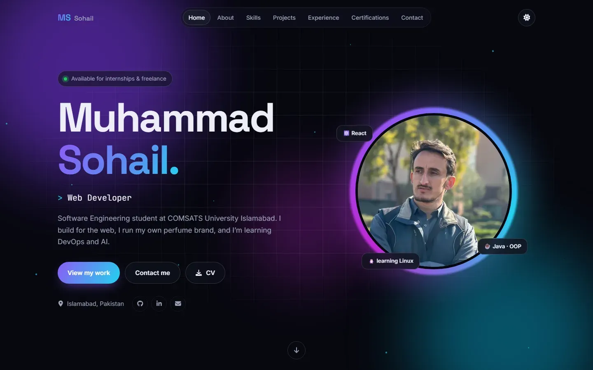

# Sohail Portfolio

The personal portfolio of **Muhammad Sohail**: Software Engineering student at COMSATS University Islamabad, web developer, and founder of [Preghal Fragrances](https://preghalfragrances.com).

**Live site:** https://my-portfolio-three-silk-27.vercel.app



## Features

- Animated hero: letter-by-letter name reveal, typing role text, drifting gradient background with particles, glowing photo ring, magnetic buttons
- Short intro animation (once per visit), scroll progress bar, back-to-top button with a progress ring
- Navbar that shrinks into frosted glass on scroll, highlights the current section, and opens a full-screen animated menu on phones
- Scroll-triggered reveals on every section
- Animated Linux terminal widget (`whoami`, `ls projects/`, `cat certifications.txt`) built from the real data files
- Projects: featured cards with 3D tilt, category filters, and a detail modal with a screenshot gallery (keyboard arrows work)
- Skills grouped by category with honest levels, plus a scrolling logo strip. No fake percentage bars
- Experience timeline whose line draws itself as you scroll
- Certifications with issuer filters and a Verify button linking to each official credential page
- Working contact form (Formspree) with validation and a success animation
- Light and dark themes, remembered in `localStorage`, defaulting to the visitor's system setting
- Respects **reduced motion**: people who turn off animations in their OS get a calm, static site
- Responsive from 360px phones up to large desktops; SEO, Open Graph preview image, accessible markup

## Tech stack

| Part | Choice |
|---|---|
| UI | React 19 (plain JavaScript) |
| Build tool | Vite |
| Animation | Framer Motion, plus CSS keyframes for always-running loops |
| Icons | react-icons |
| Styling | Plain CSS with CSS variables for theming, one CSS file per component |
| Contact form | Formspree (free tier) |
| Screenshots | Playwright + sharp (dev only) |
| Hosting | Vercel |

## Run it locally

You need Node.js 20 or newer.

```bash
git clone https://github.com/sohailwazir2004/my-portfolio.git
cd my-portfolio
npm install
npm run dev
```

Then open http://localhost:5173.

| Command | What it does |
|---|---|
| `npm run dev` | Start the dev server with hot reload |
| `npm run build` | Make a production build in `dist/` |
| `npm run preview` | Serve the production build locally (http://localhost:4173) |
| `npm run lint` | Check the code with ESLint |
| `npm run screenshots` | Re-capture project screenshots (run `npx playwright install chromium` once first) |

### Contact form setup

1. Create a free account at [formspree.io](https://formspree.io) and make a new form with your email.
2. Copy the form ID (the part after `/f/` in the form's endpoint).
3. Locally: copy `.env.example` to `.env.local` and set `VITE_FORMSPREE_ID=yourid`.
4. On Vercel: Project → Settings → Environment Variables → add `VITE_FORMSPREE_ID`, then redeploy.

Without an ID, the form still works: it opens the visitor's email app with the message filled in.

## Editing content

All text lives in `src/data/`, so you never need to touch a component to update the site:

| File | Contents |
|---|---|
| `profile.js` | Name, roles, bio, links, quick facts |
| `skills.js` | Skill groups and "currently learning" |
| `projects.js` | Projects, screenshots, filter categories |
| `experience.js` | Experience timeline and education |
| `certifications.js` | Certificates with credential IDs and verify links |
| `nav.js` | Navbar and footer links |

## Project structure

```
index.html              page shell, SEO and social-preview tags
public/                 favicon, manifest, og-image.png, resume.pdf
scripts/screenshots.mjs captures project screenshots with Playwright
src/
  main.jsx              entry point
  App.jsx               page layout: which sections, in what order
  data/                 all content (see above)
  components/           one component (+ CSS file) per section
    motion/             reusable animation pieces (Reveal, Magnetic, variants)
    projects/           project cards, tilt effect, modal gallery
  hooks/                useTheme, useActiveSection, usePointerFine
  lib/                  small helpers (intro, section scrolling)
  styles/global.css     theme colours, base styles, buttons
  assets/               profile photo and project screenshots
```

## Author

**Muhammad Sohail** · Software Engineering student, COMSATS University Islamabad
[GitHub](https://github.com/sohailwazir2004) · [LinkedIn](https://www.linkedin.com/in/muhammad-sohail-2381592bb) · sohailwazir2004@gmail.com
